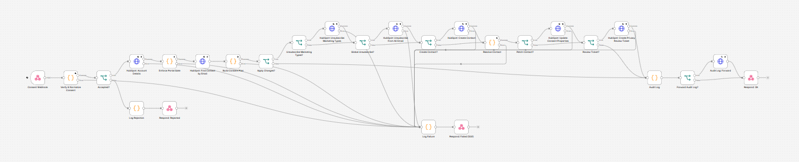
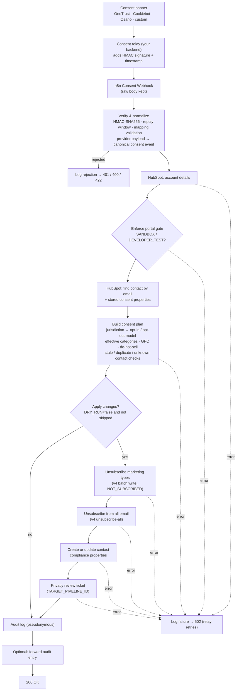

# n8n-hubspot-gdpr-ccpa-consent-preference-sync

A compliance synchronization pipeline for **n8n** and **Node.js** that connects cookie consent platforms to **HubSpot**. It works with OneTrust-, Cookiebot-, or Osano-style payloads, or a custom banner.

Each signed preference update from a consent banner is:

- **normalized** into one canonical consent event;
- **mapped**, category by category (necessary, functional, analytics, marketing, sale/sharing), to HubSpot compliance properties;
- **acted on** under the rules of the visitor's jurisdiction (GDPR opt-in or CCPA opt-out). Depending on the case, it unsubscribes marketing subscription types, sets "opted out of all email", flags do-not-sell/share, restricts processing, and opens a privacy review ticket.

I built it fail-safe. Out of the box:

- **`DRY_RUN=true`, `SANDBOX_MODE=true`, and `REQUIRE_SIGNATURE=true`.** Unsigned webhooks are rejected.
- HubSpot is used only after the portal is verified as a sandbox.
- Every request returns the full compliance plan without changing anything.

The repository contains **no real tokens, secrets, client names, or credentials**. Secrets and IDs are `your_…_here` placeholders (treated exactly like blank values), every email and domain is RFC 2606 (`example.org`), and workflow credential references use placeholder IDs.

---

## Contents

- [Architecture](#architecture)
- [Workflow nodes](#workflow-nodes)
- [Webhook payload structure](#webhook-payload-structure)
- [Consent mapping](#consent-mapping)
- [HubSpot custom property mappings](#hubspot-custom-property-mappings)
- [Regulatory rules](#regulatory-rules)
- [Compliance safeguards](#compliance-safeguards)
- [Repository layout](#repository-layout)
- [Environment variables](#environment-variables)
- [Setup guide](#setup-guide)
- [n8n import instructions](#n8n-import-instructions)
- [Edge-case handling](#edge-case-handling)
- [Testing and validation](#testing-and-validation)
- [Disclaimer & Liability Limitation](#️-disclaimer--liability-limitation)
- [License](#license)
- [Author](#author)

---

## Architecture





Most consent platforms don't sign their browser callbacks. The intended pattern is a small **relay** on your own backend: it receives the banner's consent event (or polls your platform's consent API), signs it, and forwards it to this workflow. The relay is where the visitor's email gets attached. The banner itself usually only knows an anonymous consent ID.

The same logic runs in two places:

| Runtime | Entry point | Use it for |
| --- | --- | --- |
| n8n | `workflow.json` | Production webhook handling inside n8n |
| Node.js | `src/index.js --serve` | Local testing, offline dry runs, or a small standalone service |

There is one source of truth. The config gates and consent rules live in `src/` inside `// <n8n-core:…>` markers, and `scripts/build-workflow.js` embeds those exact regions into the n8n Code nodes. The tests run the n8n Code nodes in a sandbox and prove they produce **the same compliance plan** as the Node engine. `scripts/validate-workflow.js` fails CI if any HubSpot write can be reached without its gate, or if a write has no error route.

---

## Workflow nodes

| # | Node | Type | Purpose |
| --- | --- | --- | --- |
| 1 | Consent Webhook | Webhook (raw body on) | Receives signed consent preference payloads |
| 2 | Verify & Normalize Consent | Code (transformation) | Config, HMAC check, mapping validation, provider → canonical event |
| 3 | Accepted? → Log Rejection → Respond: Rejected | IF / Code / Respond | 401, 400, or 422 with a pseudonymous audit entry |
| 4 | HubSpot: Account Details → Enforce Portal Gate | HTTP / Code | Sandbox portal verification |
| 5 | HubSpot: Find Contact by Email | HTTP | Contact plus stored consent properties |
| 6 | Build Consent Plan | Code (transformation) | GDPR / CCPA rules, effective categories, actions |
| 7 | Apply Changes? | IF | Dry runs and skips go straight to the audit log |
| 8 | HubSpot: Unsubscribe Marketing Types | HTTP | `POST /communication-preferences/v4/statuses/batch/write` |
| 9 | HubSpot: Unsubscribe From All Email | HTTP | `POST /communication-preferences/v4/statuses/{email}/unsubscribe-all?channel=EMAIL` |
| 10 | HubSpot: Create Contact → Resolve Contact → HubSpot: Update Consent Properties | HTTP / Code / HTTP | Compliance properties (409-safe) |
| 11 | HubSpot: Create Privacy Review Ticket | HTTP | Ticket in `TARGET_PIPELINE_ID`, associated to the contact |
| 12 | Audit Log → Forward Audit Log? → Audit Log: Forward | Code / IF / HTTP | Pseudonymous audit entry, optionally forwarded |
| 13 | Log Failure → Respond: Failed (502) | Code / Respond | Error handling for every HubSpot step |

---

## Webhook payload structure

### Relay signature contract

```text
POST /webhook/consent-preference-sync
Content-Type: application/json
X-Consent-Timestamp: 1794672000
X-Consent-Signature: sha256=<hex HMAC-SHA256(WEBHOOK_SIGNING_SECRET, "<timestamp>.<raw body>")>
```

The signature is verified over the **raw** body, compared in constant time, and rejected outside `SIGNATURE_TOLERANCE_SECONDS` (default 300) to block replays.

### Canonical payload (`provider: "custom"`)

```json
{
  "provider": "custom",
  "event_id": "evt_1001",
  "occurred_at": "2026-11-14T15:30:00Z",
  "receipt_id": "rcpt_evt_1001",
  "policy_version": "2026-10",
  "subject": { "email": "anna.example@example.org", "country": "DE", "region": null },
  "consents": { "necessary": true, "functional": false, "analytics": false, "marketing": false },
  "signals": {
    "gpc": false,
    "do_not_sell": false,
    "unsubscribe_all": false,
    "restrict_processing": false,
    "email_marketing_opt_in": false
  }
}
```

| Field | Required | Meaning |
| --- | --- | --- |
| `provider` | yes | Key into `providers` in the mapping (`custom`, `onetrust`, `cookiebot`, `osano`, or your own) |
| `subject.email` | yes | Contact identity (HubSpot lookup by email) |
| `occurred_at` | yes | ISO 8601 or epoch seconds/ms; older-than-stored events are ignored |
| `consents.*` | yes | Category states; missing categories follow the jurisdiction's model |
| `subject.country` / `region` | no | ISO 3166-1 alpha-2 country and subdivision code (`US` + `CA`) |
| `receipt_id` | no | Consent receipt ID; a replay of the stored receipt is skipped |
| `signals.gpc` | no | Global Privacy Control header seen by the relay |
| `signals.do_not_sell` | no | Explicit CCPA "Do Not Sell or Share" request |
| `signals.unsubscribe_all` | no | Explicit request to stop all email |
| `signals.restrict_processing` | no | GDPR Art. 18 restriction request |
| `signals.email_marketing_opt_in` | no | Recorded as a warning only; this pipeline never subscribes anyone |

### Provider shapes

The provider adapters are **mapping-driven**: field paths, category aliases, and granted/denied values all come from `config/consent-mapping.example.json`. The OneTrust-, Cookiebot-, and Osano-style shapes shipped there are **illustrative**, so I adjust the paths to match what my platform or relay actually sends. Mock payloads for all four are in `test/fixtures/consent-events.mock.json`.

| Provider | Categories format | Example |
| --- | --- | --- |
| `onetrust` | `purposes[]` array of `{ Id, TransactionType }` | `C0004` + `WITHDRAWN` → marketing denied |
| `cookiebot` | `consent{}` booleans | `statistics: false` → analytics denied |
| `osano` | `categories{}` with `ACCEPT` / `DENY` | `OPT_OUT: "ACCEPT"` → sale/sharing denied (inverted) |
| `custom` | `consents{}` booleans | as above |

---

## Consent mapping

`config/consent-mapping.example.json` controls everything without code changes:

- **`hubspot_properties`:** the internal name of each compliance property (table below).
- **`providers.<name>.paths`:** dot-paths to email, timestamp, country, region, receipt, policy version, and signals.
- **`providers.<name>.categories`:** where categories live (`object` or `array`), `aliases` from raw keys to canonical categories (an `{ "category": …, "invert": true }` alias flips the meaning), and `ignore_keys`.
- **`granted_values` / `denied_values`:** which raw values mean opt-in or opt-out. An unrecognized value is flagged, never guessed.
- **`jurisdictions`:** country and region lists with an `opt_in` or `opt_out` model. `GDPR` must be `opt_in`, and `OTHER` is the required fallback.
- **`subscriptions`:** marketing subscription type IDs to unsubscribe, plus the legal basis recorded with the change.
- **`rules`:** which actions each situation triggers.

Validation runs on every request. An invalid mapping stops processing with a specific error list.

---

## HubSpot custom property mappings

I create these **Contact** properties in a property group such as `privacy_compliance`. The internal names must match `hubspot_properties`.

| Mapping key | Default internal name | HubSpot type / field type | Written as |
| --- | --- | --- | --- |
| `necessary` | `consent_necessary` | `bool` / `booleancheckbox` | always `true` |
| `functional` | `consent_functional` | `bool` / `booleancheckbox` | `true` / `false` |
| `analytics` | `consent_analytics` | `bool` / `booleancheckbox` | `true` / `false` |
| `marketing` | `consent_marketing` | `bool` / `booleancheckbox` | `true` / `false` (cookie consent, **not** email consent) |
| `sale_sharing` | `ccpa_sale_sharing_allowed` | `bool` / `booleancheckbox` | `true` / `false` |
| `do_not_sell` | `ccpa_do_not_sell_or_share` | `bool` / `booleancheckbox` | inverse of `sale_sharing` |
| `jurisdiction` | `privacy_jurisdiction` | `enumeration` / `select` | `GDPR`, `CCPA`, `US_STATE_PRIVACY`, `OTHER` |
| `consent_model` | `privacy_consent_model` | `enumeration` / `select` | `opt_in`, `opt_out` |
| `gpc` | `privacy_gpc_signal` | `bool` / `booleancheckbox` | GPC seen on the latest event |
| `processing_restricted` | `privacy_processing_restricted` | `bool` / `booleancheckbox` | `true` once restricted (never auto-cleared) |
| `last_updated` | `consent_last_updated` | `datetime` / `date` | epoch ms of the consent event |
| `source` | `consent_source` | `string` / `text` | provider key |
| `receipt_id` | `consent_receipt_id` | `string` / `text` | receipt or event ID (replay protection) |
| `policy_version` | `consent_policy_version` | `string` / `text` | banner / policy version |

**Subscriptions.** I put the numeric IDs of my marketing email subscription types into `subscriptions.marketing_subscription_ids`; they're listed under **Settings → Marketing → Email → Subscription types**, or via the subscription definitions API. The shipped value is a placeholder, so per-type unsubscribes are skipped, with a warning, until I replace it.

**Review tickets.** I set `TARGET_PIPELINE_ID` and `TARGET_PIPELINE_STAGE_ID` to a **ticket** pipeline and stage. Tickets are associated to the contact (type 16) and contain no email address.

---

## Regulatory rules

| Situation | GDPR / UK GDPR (opt-in) | CCPA / CPRA and other opt-out states | OTHER (default opt-in) |
| --- | --- | --- | --- |
| Category not reported by the banner | Treated as **denied** | Previous stored value kept, else **allowed** | Treated as denied |
| Marketing denied | Unsubscribe the configured marketing types | Unsubscribe the configured marketing types | same |
| All non-essential categories denied | Global email unsubscribe (`global_unsubscribe_on_full_withdrawal`) | same | same |
| Global Privacy Control signal | Sale/sharing → not allowed (`honor_gpc_as_do_not_sell`) | Sale/sharing → not allowed; do-not-sell = true | same |
| Explicit `do_not_sell` | Do-not-sell = true | Do-not-sell = true | same |
| Explicit `unsubscribe_all` | Global email unsubscribe | Global email unsubscribe | same |
| Explicit `restrict_processing` | Processing restricted + review ticket | same | same |
| Full withdrawal (optional rule) | Restrict processing if `restrict_processing_on_full_withdrawal_gdpr` | — | — |
| Marketing **granted** | Recorded only; **never subscribes** | Recorded only | Recorded only |

The US state list in the example mapping is illustrative. I maintain the jurisdictions that apply to me with my counsel.

---

## Compliance safeguards

These invariants are enforced in code, whatever the mapping says:

1. **Never subscribes.** The only subscription states this pipeline writes are `NOT_SUBSCRIBED` and "opted out of all". Accepting marketing cookies is not consent to marketing email.
2. **Never un-restricts.** An existing processing restriction is kept until a human lifts it. A global unsubscribe is never reversed.
3. **Never goes backwards in time.** An event older than the stored `consent_last_updated` is skipped, and a replay of the stored `consent_receipt_id` is skipped.
4. **Withdrawals first.** Unsubscribes run before property updates, so the most important effect lands even if a later step fails. On failure the webhook returns **502**, so the relay retries, and retries are idempotent.
5. **Essential cookies are always granted**, even if a banner reports otherwise.
6. **Minimal data.** Audit entries and failure logs carry a pseudonymous hash, never the email address. Unknown contacts are **not** created unless `CREATE_MISSING_CONTACTS=true`.
7. **No action without a confirmed lookup.** If the HubSpot contact search fails, nothing is written.

---

## Repository layout

```text
n8n-hubspot-gdpr-ccpa-consent-preference-sync/
├── README.md                          This file
├── DISCLAIMER.md                      Disclaimer & liability limitation
├── LICENSE                            MIT License, Copyright © 2026 dhRobin Systems
├── workflow.json                      Importable n8n workflow (generated, placeholder credential IDs)
├── package.json                       Zero dependencies; test and validation scripts
├── .env.example                       Environment template (placeholders only)
├── .gitignore
├── config/
│   └── consent-mapping.example.json   Category → HubSpot property mapping, providers, jurisdictions, rules
├── scripts/
│   ├── build-workflow.js              Generates / checks workflow.json from src/
│   └── validate-workflow.js           Structural, gate, credential, and error-route validator (CI)
├── src/
│   ├── consent.js                     Signature, mapping validation, normalization, jurisdictions, plan, audit
│   ├── config.js                      Fail-safe environment loader and portal gate
│   └── index.js                       Standalone webhook server and HubSpot client
└── test/
    ├── consent.test.js                44 tests incl. n8n parity and repository security scan
    └── fixtures/
        └── consent-events.mock.json   Mock events (4 providers, 11 scenarios) and HubSpot responses
```

---

## Environment variables

`.env.example` ships with placeholders (`your_…_here`) and fail-safe defaults. Placeholders behave exactly like blank values.

| Variable | Default | Purpose |
| --- | --- | --- |
| `DRY_RUN` | `true` | Return the plan; write nothing |
| `SANDBOX_MODE` | `true` | Verified sandbox / developer-test portal only |
| `ALLOW_PRODUCTION_MODE` | `false` | Required for `SANDBOX_MODE=false` |
| `HUBSPOT_PRIVATE_APP_TOKEN` | placeholder | Private app token (standalone engine) |
| `HUBSPOT_BASE_URL` | HubSpot API | Must be `https://` |
| `HUBSPOT_SANDBOX_PORTAL_ID` | placeholder | Optional pin to one sandbox portal |
| `TARGET_PIPELINE_ID` / `TARGET_PIPELINE_STAGE_ID` | placeholders | Ticket pipeline and stage for privacy review tickets |
| `CREATE_MISSING_CONTACTS` | `false` | Create contacts for unknown subjects |
| `WEBHOOK_SIGNING_SECRET` | placeholder | HMAC secret shared with the relay |
| `REQUIRE_SIGNATURE` | `true` | Reject unsigned webhooks |
| `SIGNATURE_TOLERANCE_SECONDS` | `300` | Replay window (30–900) |
| `CONSENT_MAPPING_FILE` / `CONSENT_MAPPING_JSON` | placeholders | Mapping for the standalone engine / n8n (the example mapping is dry-run only) |
| `AUDIT_LOG_WEBHOOK_URL` | placeholder | Optional HTTPS endpoint for audit entries |
| `HOST` / `PORT` | `127.0.0.1` / `8791` | Standalone bind address |

**HubSpot private app scopes:** `crm.objects.contacts.read`, `crm.objects.contacts.write`, `communication_preferences.statuses.batch.write`, `communication_preferences.write` (or `communication_preferences.read_write`), and `tickets` if review tickets are on. The account-info call used by the sandbox gate may need an extra scope; if so, HubSpot names it in the error.

---

## Setup guide

1. **Verify locally (no credentials):**

   ```bash
   npm run verify    # workflow in sync + validator + 44 tests
   npm run dry-run   # plans the first mock event offline and prints the result
   ```

2. **Create the HubSpot properties** from the table above in a **developer test account or sandbox**. Create a private app with the scopes listed.
3. **Copy and edit the mapping:** `cp config/consent-mapping.example.json config/consent-mapping.json`. Then:
   - set the real marketing subscription type IDs;
   - adjust provider paths and aliases to match your consent platform;
   - review the jurisdictions and rules with your privacy counsel.

   (`config/*.json` other than the example is git-ignored.)
4. **Build the relay.** It receives the banner's consent change, attaches the visitor's email (for logged-in users or known leads), signs the body with `WEBHOOK_SIGNING_SECRET`, and POSTs it to the webhook.
5. **Run standalone (optional):** `cp .env.example .env`, fill in the values, then `node --env-file=.env src/index.js --serve`.

---

## n8n import instructions

1. **Workflows → Import from File** → `workflow.json`. It imports **inactive**.
2. Open every `HubSpot:` node and replace the placeholder credential (`your_n8n_hubspot_credential_id_here`) with a **HubSpot App Token** credential for the *sandbox* private app.
3. Set n8n environment variables:
   - `NODE_FUNCTION_ALLOW_BUILTIN=crypto`. This is required for signature checks; without it, every webhook is rejected (fail closed).
   - `WEBHOOK_SIGNING_SECRET`.
   - `CONSENT_MAPPING_JSON`, your mapping as single-line JSON (`node -e "console.log(JSON.stringify(require('./config/consent-mapping.json')))"`).
   - `TARGET_PIPELINE_ID` and `TARGET_PIPELINE_STAGE_ID` (optional) and `AUDIT_LOG_WEBHOOK_URL` (optional).
   - If `$env` access is blocked in Code nodes, the secret can't be read and every webhook is rejected. All other settings fall back to their fail-safe defaults.
4. Keep the **Consent Webhook** node's **Raw Body** option on.
5. Activate the workflow and point the relay at the production webhook URL.
6. Go live in stages:
   - Dry run: review each plan in the webhook response and execution log.
   - `DRY_RUN=false` in sandbox mode: real writes to the sandbox portal.
   - `SANDBOX_MODE=false` with `ALLOW_PRODUCTION_MODE=true` and production credentials: production.

---

## Edge-case handling

| Situation | What happens |
| --- | --- |
| Unsigned, tampered, or replayed request | 401 before any API call; pseudonymous rejection logged |
| Unknown provider, missing email, or missing categories | 422 with reasons |
| Event timestamp more than 10 minutes in the future | 422 (`occurred_at_in_future`) |
| Out-of-order delivery (older than stored consent) | Skipped (`stale_event_older_than_stored_consent`) |
| Relay retry of an applied receipt | Skipped (`duplicate_receipt`) |
| Contact not in HubSpot | Skipped (`contact_not_found`) unless `CREATE_MISSING_CONTACTS=true` |
| Contact created concurrently (409) | Existing ID parsed; properties patched |
| Several raw categories map to one canonical category | Any denial wins |
| Unmapped category or unrecognized value | Ignored with a warning, never guessed |
| Placeholder subscription type ID | Per-type unsubscribe skipped with a warning; global rules still apply |
| Review trigger without `TARGET_PIPELINE_ID` | Warning; no ticket |
| HubSpot error on any step | Log Failure → 502; the relay retries; steps are idempotent |
| Contact lookup failure | Nothing written; 502 |
| Invalid mapping | Processing stops with a full error list |
| Country missing | `OTHER` jurisdiction (opt-in by default) |

---

## Testing and validation

```bash
npm test                    # 44 tests (node --test)
npm run validate:workflow   # structural, gate, credential, and error-route validation
npm run check:workflow      # workflow.json in sync with src/
npm run verify              # all three
```

The suite covers:

- **Config:** defaults, placeholders treated as blank, strict flags, the production opt-in, pipeline/stage pairing, secret requirement and redaction, and the portal gate.
- **Signatures:** valid, tampered, replayed, malformed, missing, and placeholder secrets.
- **Mapping validation:** the example passes, with its placeholder warning; specific errors for a GDPR opt-out model, bad or duplicate properties, overlapping values, unknown categories, legal basis, rule types, and a missing fallback.
- **Normalization:** each provider shape, any-denial-wins, inverted Osano opt-out, ignored keys, epoch timestamps, unmapped and unrecognized values, and rejection reasons.
- **Jurisdictions:** GDPR (EU, EEA, UK), CCPA, other US states, and the fallback.
- **Plan rules:** full withdrawal, missing subscription IDs, never-subscribe, CCPA with GPC and kept-previous defaults, restriction with ticket, the never-lift guarantee, the optional GDPR restriction rule, stale / duplicate / unknown contact, contact creation, essential-always-granted, no-op suppression, and a pseudonymous audit.
- **Engine:** documented outcomes for all 11 mock events, rejection before any API call, the gate, lookup failure, write ordering (withdrawals → properties → ticket), the 409 path, dry runs that never write, the mapping requirement, and HTTP 200 / 401 / 502.
- **n8n workflow:** the validator (including negative cases), the verify node with signed raw bodies and with `$env` blocked, **plan parity with the Node engine across eight scenarios**, resolve-node paths, and audit / failure logs free of email addresses.
- **Security scan:** fails on private keys, HubSpot tokens and legacy keys, JWTs, Google, AWS, GitHub, Slack, and Stripe keys, hard-coded secrets (placeholders excepted), any non-placeholder secret or ID in `.env.example`, a committed `.env`, email addresses outside RFC 2606 (plus the author contact), and domains outside RFC 2606 or a short allowlist (the author links and the HubSpot API host). It tests itself against planted secrets.

---

## ⚠️ Disclaimer & Liability Limitation

**Use at your own risk.** The code, workflows, and scripts provided in this repository (`n8n-hubspot-gdpr-ccpa-consent-preference-sync`) are for educational and architectural demonstration purposes. They are not legal advice.

* **No Liability:** The author and dhRobin Systems assume no responsibility or liability for any direct, indirect, incidental, or consequential damages resulting from the use, misuse, or deployment of these scripts, including compliance breaches, regulatory fines, misapplied opt-outs, and data loss.
* **No Warranty:** All software, n8n JSON blueprints, and JavaScript modules are provided "AS IS" without warranty of any kind, express or implied, including but not limited to merchantability, fitness for a particular purpose, or non-infringement.
* **Production Testing Required:** Always test thoroughly in an isolated staging environment (for example a HubSpot developer test account or sandbox) with `SANDBOX_MODE=true` and `DRY_RUN=true` enabled before connecting live HubSpot credentials. Treat every unsubscribe, global opt-out, and processing restriction as something that cannot be undone.
* **Third-Party APIs & Compliance:** Users are solely responsible for complying with the terms of service, rate limits, data privacy regulations (GDPR/CCPA), and security policies of HubSpot, their consent platform, and any connected services. That includes mapping each banner category to the correct legal effect, honouring Global Privacy Control where required, securing the webhook relay and its signing secret, and reviewing every automated subscription and property change.

The full disclaimer is also available in [DISCLAIMER.md](https://github.com/dhrobinsystems/n8n-hubspot-gdpr-ccpa-consent-preference-sync/blob/main/DISCLAIMER.md).

## License

Released under the MIT License. Copyright (c) 2026 DH Robin (dhRobin Systems). See [LICENSE](https://github.com/dhrobinsystems/n8n-hubspot-gdpr-ccpa-consent-preference-sync/blob/main/LICENSE).

## Author

**DH Robin** (Revenue Infrastructure Architect | HubSpot CRM Architecture | RevOps Automation | Outbound Systems) — `https://dhrobinsystems.com` | `robin@dhrobinsystems.com`

---

> DISCLAIMER: Provided as-is without warranty of any kind, express or implied. The author and dhRobin Systems shall not be held liable for any compliance breaches, regulatory fines, data loss, or damages arising from the use of this code or workflow. Users are solely responsible for verifying their own legal and regulatory compliance posture under GDPR, CCPA, and applicable privacy laws.
> 
> Full text: DISCLAIMER.md · Licensed under the MIT License. License: MIT © 2026 dhRobin Systems · Provided as-is, see the disclaimer.
